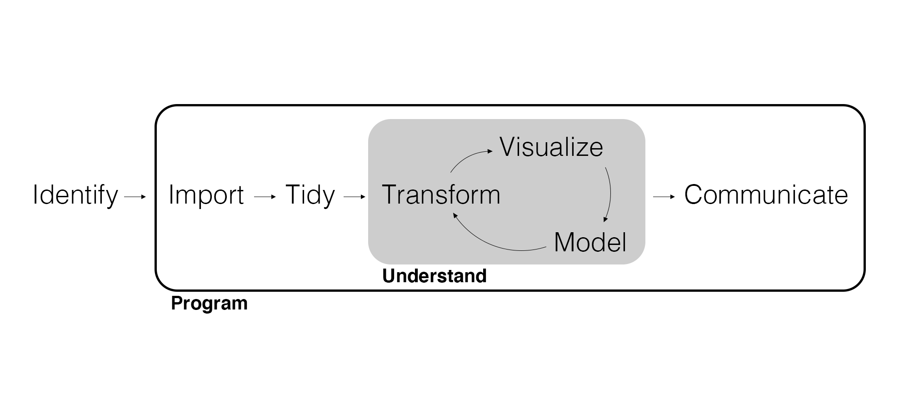

## Feedback Points From First Project

- Professional Submissions
- Reproducible Analysis
- Structured Analytics Workflow
- Clear Communication of Insights

## We're Looking for Professional-Grade Project Files

**Takeaway**: Students should submit *clean*, *minimal*, *professional* project files that run without producing extra files or unnecessary clutter.

- Do not include code that writes new files (such as `.csv` files) *in your final submission* (it's okay to do this as you are working on the project)
- Remove auto-generated Quarto description when you create a new Quarto file.

## Increased Attention to Reproducible Code Execution

**Takeaway**: Projects should be written so the entire analysis executes cleanly in one run, with *all relevant outputs automatically displayed*.

- If your analysis uses an output to draw conclusions or make decisions (*e.g.* a table or plot) then make sure that output is printed out.
- Senior partners should be able to click "Run All" before reading through all code and output.

## Run-All Test

1. Restart your R session.
2. Open your code file.
3. Click `Run All` (or render the document).
4. Scroll through the output.

*Your Project Passes the Test IF*:

- The code runs without errors.
- All tables and visualizations appear automatically.
- There is no need to re-run individual lines of code.
- Your interpretations remain consistent with the displayed results.

## Follow the Marketing Analytics Workflow

**Takeaway**: Students should follow the workflow that we've developed throughout the semester. See the `analysis-framework.pdf` document on Canvas.

- Senior partners noticed patterns of **skipping data cleaning**.
- Outliers were often left unaddressed, which can cause visual issues in plots.

## Match Your Work to This Process

{width=900px}

## Include Clear Documentation and Interpretation

**Takeaway**: Your report should directly and explicitly connect your *code* to your *results*, your *results* to your *insights*, and your *insights* to your *recommendations*.

- Explain what each code chunk does, and why.
- Interpret the results of each table and visualization in the context of your business problem/pain point.
- Many people can write code. Not many people can draw insights from code that are relevant to a business, and use those insights to make recommendations. *Always* link your findings to recommendations.
